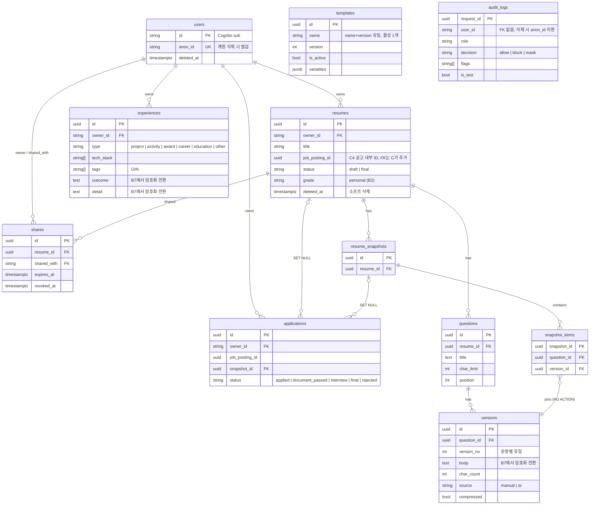

# 데이터 모델 v0 (B1)

마이그레이션: `0002` B1 핵심 테이블, `0003` B2 문서 등급
소유: B (모델 추가는 B가 취합, tasks.md 디렉터리 소유). **C·D 리뷰 요청 대상.**

## ERD

## 규칙

| 규칙 | 구현 | 근거 |
|---|---|---|
| 모든 ID는 UUID(서버 기본값 `gen_random_uuid()`), 사용자 ID만 Cognito sub 문자열 | `_common.UuidPk` | IDOR 방지 |
| 하위 테이블에도 `owner_id` 중복 저장 | `_common.owner_fk()` | 소유 필터·RLS를 JOIN 없이 적용 |
| 사용자 물리 삭제 시 소유 문서 CASCADE | `owner_id ... ON DELETE CASCADE` | B20 |
| 감사 로그는 사용자 삭제 후에도 보존 | `audit_logs.user_id` FK 없음 | spec 10.2 |
| 버전은 INSERT 전용 | `versions_immutable` 트리거 | spec 3.1 |
| 스냅샷이 참조하는 버전은 단독 삭제(압축) 불가 | `snapshot_items.version_id` FK NO ACTION | part2_guide 4.2 |
| 지원 기록은 자소서 삭제 후에도 유지 | `applications.resume_id/snapshot_id` SET NULL | spec 4.5 |
| 값 목록은 PG ENUM 대신 CHECK 제약 | `_common.one_of()` | 값 추가 시 마이그레이션 단순 |
| 이름별 활성 템플릿 1개 | 부분 유일 인덱스 `uq_templates_active_name` | spec 3.6 |
| 제약 이름 규칙 고정 | `app.db.NAMING_CONVENTION` | 후속 마이그레이션에서 이름으로 수정 |
| 문서 등급 `grade` (public/internal/personal/sensitive/confidential) | `_common.Grade`, 테이블별 기본값 + CHECK | spec 6.2, 6.4 (B2) |
| 공유 정보(shared_with·expires_at)의 원본은 `shares` | 검색 필터는 조인 권장, 부분 인덱스 `ix_shares_active_lookup` | spec 3.7 즉시 접근 불가 |

### 테이블별 기본 등급 (spec 6.4)

| 등급 | 테이블 |
|---|---|
| personal | resumes, questions, versions, experiences, applications |
| internal | templates |
| sensitive | audit_logs |

ORM을 거치지 않는 INSERT에도 DB 기본값으로 같은 등급이 붙는다. 클라이언트 입력으로 등급을 바꾸지 못하게 하는 것은 B8(서비스 계층).

## 후속 마이그레이션 예정

| 태스크 | 변경 |
|---|---|
| B3 | 감사 로그 테이블 권한(앱 계정 INSERT·SELECT만), 보관 기간 정리 |
| B7 | `user_keys`, `pii_token_map`, 본문·경험 컬럼 암호화 전환 |
| B12·B13 | `documents`, `interview_questions`, `practice_answers` |
| B20 | `deletion_jobs` |
| C4 | 공고 테이블 + `resumes.job_posting_id`, `applications.job_posting_id` FK |

## 리뷰 요청 사항

- **C**: `applications` 기본 컬럼과 상태값, 지원 기록이 `resume_snapshots`를 참조하는 방식(part2_guide 4.10), 공고 FK 추가 시점
- **D**: 역할 값(`user/mentor/operator/system`)이 D1 정의와 일치하는지, `app/app/db.py` 이름 규칙 변경(커밋 `3a8da62`)
