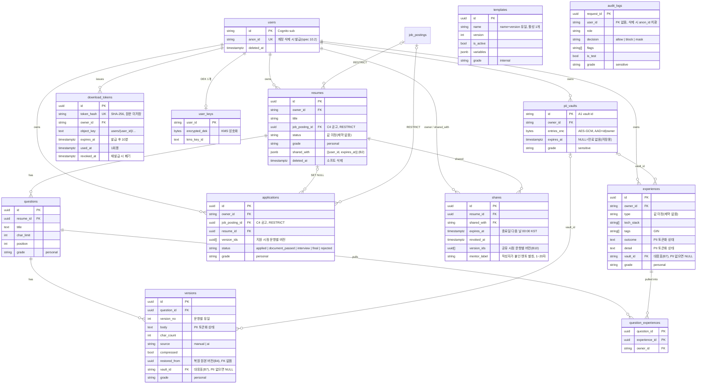

# 데이터 모델 (B1, B2)

마이그레이션: `0002` B1 핵심 테이블, `0003` B2 문서 등급·공유 컬럼, `0004` B4 복원 출처, `0005` B5 문항↔경험 연결, `0006` B6 다운로드 토큰, `0007` B3 감사 로그 무결성, `0008` B7 PII 대응표·사용자 키, `0009` B11 감사 로그 변조 방지, `0010` C4 공고 테이블 취합·공고 FK, `0011` B7 버전·경험 대응표 참조, `0012` B10 공유 버전 고정, `0013` C·A 모델 취합(수집 기록·임베딩·학습·말투 프로필), `0014` B10 멘토 별칭
소유: B (모델 추가는 B가 취합, tasks.md 디렉터리 소유). **C·D 리뷰 요청 대상.**

## ERD

## 규칙

| 규칙 | 구현 | 근거 |
|---|---|---|
| 모든 ID는 UUID(서버 기본값 `gen_random_uuid()`), 사용자 ID만 Cognito sub 문자열 | `_common.UuidPk` | |
| 하위 테이블에도 `owner_id` 저장 | `_common.owner_fk()` | spec 3.1 "owner_id 필수" |
| 사용자 물리 삭제 시 소유 문서 CASCADE | `owner_id ... ON DELETE CASCADE` | B20 |
| 감사 로그는 사용자 삭제 후에도 보존 | `audit_logs.user_id` FK 없음 | spec 10.2 |
| 버전은 INSERT 전용 | `versions_immutable` 트리거 | spec 3.1 "덮어쓰지 않음" |
| 지원 기록은 지원 시점 버전을 고정 참조 | `applications.version_ids` (문항별 버전 ID 배열) | spec 4.5 |
| 지원 기록은 자소서 삭제 후에도 유지 | `applications.resume_id` SET NULL | spec 4.5 |
| 이름별 활성 템플릿 1개 | 부분 유일 인덱스 `uq_templates_active_name` | spec 3.6 |
| 문서 등급 5종, 테이블별 기본값 | `_common.Grade`, CHECK 제약 | spec 6.2, 6.4 (B2) |
| 문항에 끌어온 경험 기록 | `question_experiences` (문항·경험 삭제 시 CASCADE) | B5 "자소서 문항에 끌어오기" |
| 다운로드 토큰은 해시만 저장, 10분·1회용, 만료 24시간 후 정리 | `download_tokens`, `core/storage/tokens.py` | spec 3.2, part2_guide 4.1, 4.23 (B6) |
| 감사 로그 무결성: doc_grades 5등급만, `test-` 접두어⇔is_test, query_hash SHA-256 형식 | `audit_logs` CHECK 3종 | spec 10.1, part2_guide 4.25 (B3) |
| 감사 로그 수정·삭제 방지: UPDATE는 user_id→anon_id 익명화만, DELETE는 90일 지난 행만, TRUNCATE 거부 | `audit_logs_guard` 트리거 | 팀 합의, part2_guide 4.29 (B11) |
| 감사 로그 doc_ids·doc_grades 길이 일치 | `audit_logs` CHECK | A8 1:1 기록 (B11) |
| 감사 로그 90일 보관 | `features/audit/retention.py` (1회 최대 5,000행, 오래된 순) | spec 10.2 (B3) |
| PII 대응표는 사용자별 DEK로 암호화, DEK는 KMS 암호화 상태로만 저장 | `user_keys`, `pii_vaults`, `app/app/pii/envelope.py` | spec 8.3, tasks B7 |
| 저장용 대응표는 만료 없음, LLM용은 만료 후 열람 시·정리 배치로 삭제 | `pii_vaults.expires_at`, `pg_vault_store.cleanup_expired` | part2_guide 4.26, 4.28 |
| 등급은 저장 시 기능별 고정값으로 자동 부여, 이후 변경 불가 | `app/app/models/grading.py` | tasks B8, spec 6.4 |
| 버전·경험은 자기 대응표를 가리키고, 대응표는 참조 행을 먼저 지운 뒤 삭제(NO ACTION) | `versions.vault_id`, `experiences.vault_id` | part2_guide 4.33 |
| 참조 중인 공고는 물리 삭제 불가. 계정 삭제 시 본인 입력 공고는 함께 삭제 | `resumes`·`applications.job_posting_id` RESTRICT | part2_guide 4.30 |
| 공유 대상·멘토별 만료 | `resumes.shared_with` JSONB 배열, 원본은 `shares` (B10에서 동기화) | tasks B2, spec 3.7 |
| 값 목록이 문서에 정의된 컬럼만 CHECK 제약 | `_common.one_of()` | versions.source, applications.status, audit_logs 등 |

### 테이블별 기본 등급 (spec 6.4)

| 등급 | 테이블 |
|---|---|
| personal | resumes, questions, versions, experiences, applications |
| internal | templates |
| sensitive | audit_logs |

ORM을 거치지 않는 INSERT에도 DB 기본값으로 같은 등급이 붙는다. 클라이언트 입력으로 등급을 바꾸지 못하게 하는 것은 B8.

## 구현용 보조 요소 (문서 기능을 구현하기 위해 추가)

| 요소 | 용도 | 관련 문서 |
|---|---|---|
| `users.anon_id` | 계정 삭제 시 감사 로그 user_id를 치환할 익명화 토큰 | spec 10.2 |
| `questions.position` | 문항 표시 순서 | spec 3.1 |
| `versions.version_no`, `char_count` | 버전 번호, 글자 수 제한 비교 | spec 3.1 |
| `versions.compressed` | 50개 초과 시 압축된 보관 요약 행 표시 | spec 3.1 |
| `versions.restored_from` | 이전 버전 복원 시 원본 버전 ID. UPDATE 금지 트리거와 FK 연쇄(SET NULL)가 충돌해 FK 없음 | spec 3.1 (B4) |
| `templates.created_by` | 템플릿 수정 이력(작성 운영자) | spec 3.6 |
| `shares` 부분 인덱스 `ix_shares_active_lookup` | 멘토별 유효 공유 조회 | spec 3.7 |

## 후속 태스크에서 처리

| 태스크 | 변경 |
|---|---|
| B4 | 버전 압축 시 `applications.version_ids`가 참조하는 버전 제외(배열은 FK 보호 불가) |
| B10 | `shares` ↔ `resumes.shared_with` ↔ 벡터 메타데이터 동기화 |
| B12·B13 | PDF·면접 연습 테이블 |
| B20 | 삭제 작업 테이블 |
| C14 | `learning_roadmaps.job_posting_id` FK(C 협의 중) |

## 팀 확정 필요

| 항목 | 현재 상태 |
|---|---|
| `resumes.status` 값 목록 | 문서에 없음 → 제약 없음 |
| `experiences.type` 값 목록 | 문서는 예시만(프로젝트·활동·수상 등) → 제약 없음 |
| 역할·등급 명칭 (D1) | `user/mentor/operator/system`, `public/internal/personal/sensitive/confidential` 잠정 |

## 리뷰 요청 사항

- **C**: `applications` 컬럼·상태값, `version_ids` 참조 방식, 공고 FK 추가 시점, `resumes.shared_with` 형식(벡터 메타데이터 반영 C3)
- **D**: 역할·등급 명칭과 D1 일치 여부, `app/app/db.py` 이름 규칙 변경
